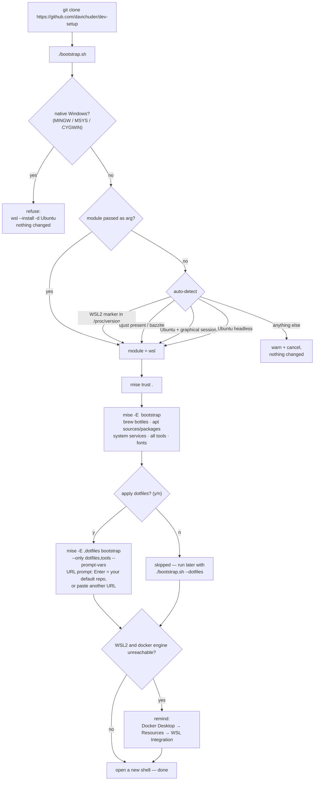
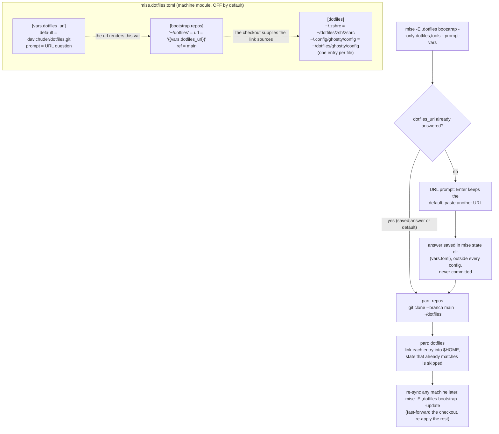

# dev-setup

Portable developer-machine bootstrap for **WSL2 Ubuntu, Ubuntu desktop, Ubuntu Server and Bazzite**, on one primitive: [`mise bootstrap`](https://mise.jdx.dev/bootstrap.html). One command per machine, everything declarative, everything versioned here.

## Usage

One line — clone, enter, run (interactive; it auto-detects your machine and asks y/n about dotfiles):

```sh
git clone https://github.com/davichuder/dev-setup.git ~/dev-setup && cd ~/dev-setup && ./bootstrap.sh
```

The other two modes only change what their flags do; everything else is identical:

```sh
./bootstrap.sh --no-dotfiles   # fully automatic: zero prompts (ideal for a clean WSL distro);
                               # also leaves your login shell untouched
./bootstrap.sh wsl --dotfiles  # force module + apply dotfiles; flags go in any order:
                               # desktop | wsl | bazzite | server, --dotfiles, --no-dotfiles,
                               # --zsh, --no-zsh (make brew zsh the login shell)
```

Interactive runs ask two questions: **dotfiles now? (y/n)** — "y" opens a URL prompt, Enter keeps your default repo — and **make zsh the default login shell? (y/n)**; answering n keeps your current shell, and non-interactive runs never change it.

The module is auto-detected, in this order:

1. `/proc/version` mentions Microsoft → **wsl**
2. a Fedora Atomic image with `ujust` (`ujust` in PATH or "bazzite" in os-release) → **bazzite**
3. Ubuntu with a graphical session (`$XDG_SESSION_TYPE` x11/wayland, or `graphical.target` active) → **desktop**
4. Ubuntu headless (tty/ssh session) → **server**

Anything else prints a warning and cancels without changing anything.

After it finishes: open a new shell (mise activation block is written into your shell startup files). Tools then resolve in any directory too — the script writes the base `[tools]` table into a global mise fragment (`~/.config/mise/conf.d/dev-setup-tools.toml`), because the project config alone only applies inside the checkout.

## Requirements

- **Supported targets only**: WSL2 Ubuntu, Ubuntu desktop, Ubuntu Server 24.04+, or any Bazzite image. **Native Windows is not supported** — bootstrap.sh refuses there; the Windows path is WSL2 (`wsl --install -d Ubuntu`, then run the script inside the distro).
- **`curl` and `git`** on the machine (needed to fetch this repo and run the script; mise installs itself and everything else).
- **`sudo` rights**: apt sources/packages, rpm-ostree layering and system services run with sudo when a change needs root.
- **apt ≥ 2.4** (Ubuntu 22.04+/Debian 12+): mise writes inline-signed apt repository keys.
- **A few GB free disk**: runtimes (node, python, go, rust, java) plus ~40 CLIs land in `~/.local/share/mise` and the brew prefix.
- **Fonts**: need fontconfig (`fc-cache`); headless servers skip the font task automatically.
- **WSL2 + Docker**: install Docker Desktop on Windows and enable *Settings > Resources > WSL Integration > this distro* — the script reminds you at the end only when the Docker engine is not reachable from the distro.
- **Network**: required on first run (bottles, runtimes, apt sources, fonts).

## Installation flow



## How it is divised

| File | Contains |
|---|---|
| `mise.toml` | Base for every machine: 5 runtimes + 35 CLIs (`[tools]`), Homebrew formulae (`brew:` — mise installs bottles, no Homebrew needed), `zsh` login-shell activation, idempotent font task |
| `mise.desktop.toml` | Ubuntu desktop: Ghostty (PPA), Docker Engine, Tailscale + services |
| `mise.wsl.toml` | WSL2: Ghostty (PPA, WSLg); Docker comes from Docker Desktop on Windows |
| `mise.bazzite.toml` | Bazzite: Ghostty via COPR + `rpm-ostree`; Docker/SSH already in the image |
| `mise.server.toml` | Ubuntu Server: Docker Engine, Tailscale, `openssh-server` + services |
| `mise.dotfiles.toml` | Optional module: clones `github.com/davichuder/dotfiles` into `~/dotfiles` and links files; only applied when you accept |
| `bootstrap.sh` | Installs mise if missing, picks the module, runs `mise bootstrap`, optional dotfiles step, WSL2 Docker Desktop reminder |
| `scripts/install-fonts.sh` | 6 core Nerd Fonts → `~/.local/share/fonts` (idempotent) |
| `scripts/install-ghostty-bazzite.sh` | COPR + `rpm-ostree` layering for Ghostty (idempotent) |

## Dotfiles — example structure and sync

### How the dotfiles flow works inside mise



The dotfiles repository (`davichuder/dotfiles` by default; any URL at the prompt) is just a Git checkout: `mise` clones it into `~/dotfiles` and links individual files with `[dotfiles]` entries. Example layout — one directory per app, plain files, nothing else needed:

```text
dotfiles/
├── zsh/
│   └── zshrc                # → ~/.zshrc
├── ghostty/
│   └── config               # → ~/.config/ghostty/config
├── gitignore-global         # → ~/.config/git/ignore
└── powerlevel10k/
    └── p10k.zsh             # → ~/.p10k.zsh
```

Each arrow is one entry in `mise.dotfiles.toml`:

```toml
[dotfiles]
"~/.zshrc" = "~/dotfiles/zsh/zshrc"
"~/.config/ghostty/config" = "~/dotfiles/ghostty/config"
```

Keep it in sync with the upstream repo (after bootstrap, on any machine):

```sh
mise -E <module>,dotfiles bootstrap --update   # pulls declared repos + re-applies state (idempotent)
mise -E wsl,dotfiles bootstrap --update        # example: this is what it looks like on WSL2
```

Use a different repository than the default (yours instead of `davichuder/dotfiles`, or a fork):

```sh
mise vars prompt dotfiles_url      # re-ask: Enter keeps the default, paste another URL
mise vars unset dotfiles_url       # forget the saved answer, asked again next time
mise -E <module>,dotfiles bootstrap --update
```

Saved answers live in mise's state directory, outside every config file — never committed here.

## Key facts baked into the design

- **mise, not brew, runs the installs.** Formulae land in the standard Homebrew prefix (`/home/linuxbrew/.linuxbrew`) with Homebrew-compatible receipts — おbrew stays compatible without being required.
- **Ghostty** is not in Homebrew for Linux: it comes from the `mkasberg/ghostty-ubuntu` PPA (Ubuntu/WSL2) or the `scottames` COPR layered with `rpm-ostree` (Bazzite). Verified docs: ghostty.org/docs/install/binary.
- **Per-OS divergence is a module, not an if/else**: undeclared managers are skipped on other platforms, so base + module never fight.
- **Idempotent everywhere**: `mise bootstrap` skips already-matching state; fonts and random scripts guard themselves; safe to re-run.
- **Secrets never in git**: if a template ever needs one, use `[bootstrap.secrets]` (env-backed), never literal values.

## Everyday commands

```sh
mise bootstrap --yes                 # bring this machine to the declared state
mise -E bazzite bootstrap --dry-run  # preview what would change
mise bootstrap packages upgrade      # upgrade brew/apt formulae to latest
mise bootstrap --update              # refresh metadata + declared repos
mise bootstrap unapply dotfiles      # remove what the dotfiles module deployed
```

## First run notes

- WSL2 + Docker Desktop: enable **Settings > Resources > WSL Integration** for the distro (bootstrap.sh prints the reminder).
- Bazzite: after the Ghostty layer, one reboot applies it.
- `mise bootstrap` runs with `sudo` only where a change requires root (apt sources/packages, rpm-ostree); it never runs privileged work without a declared change.
